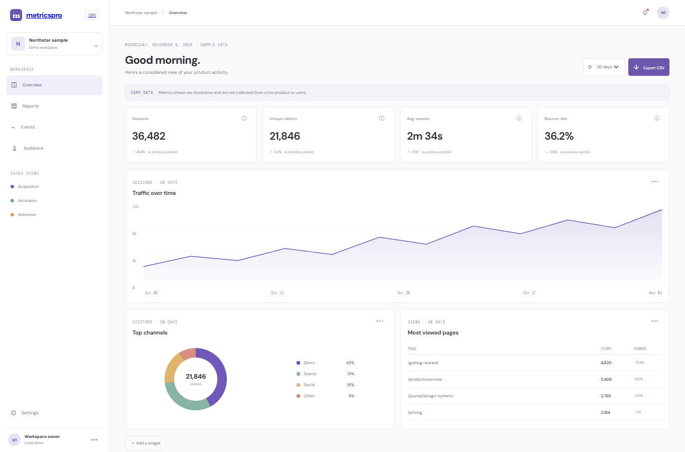

# MetricsPro

A sample product analytics workspace concept with interactive date ranges, visualization widgets, and CSV export. All metrics, routes, and workspace labels are illustrative; no visitor tracking or customer data is used.

## Run locally

From the workspace root, run `npm install`, then `npm run dev --workspace=metricspro-saas` and open `http://localhost:3009`. For production, run `npm run build --workspace=metricspro-saas` and `npm run start --workspace=metricspro-saas`.

## Features

- Change date range to update sample metric cards and SVG trend chart.
- Add and remove sample dashboard widgets; channel and page visualizations are local.
- Export the current metric summary as CSV.
- Responsive dashboard layout.

## Scope

There is no multi-tenant authentication, event ingestion, PostgreSQL/Redis backend, live analytics, report scheduler, API-key system, Stripe billing, webhooks, or customer data. Widget changes reset on reload. No real traffic has been measured.

## Tech stack badges

  

## Screenshots

## Environment variables

No environment variables are required. This showcase uses local sample data and runs without paid APIs or external credentials.
